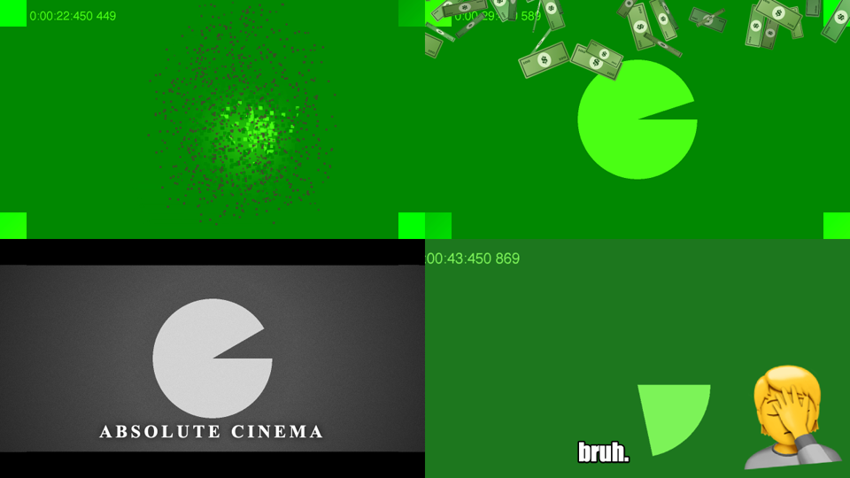

# Meet Snap FX

A Chrome extension that gives your Google Meet calls a plot. 🫰

| Gesture | Effect |
| --- | --- |
| Snap once | You turn to dust, Endgame style, then fade back in |
| Snap twice | It rains cash |
| Both hands up | Absolute cinema |
| Facepalm | You already know who shows up |

No green screen, no editing, no virtual-camera app. The effects are drawn into your camera feed, so everyone in the call sees them live. Everything runs on your machine.



## Install

1. Download this repo: **Code → Download ZIP**, then unzip it somewhere permanent (not Downloads, which gets cleaned up). Or `git clone` it.
2. Open `chrome://extensions` and turn on **Developer mode** (top right).
3. Click **Load unpacked** and pick the folder that contains `manifest.json`.
4. Pin the extension, then reload any open Meet tabs.

Works in Chrome and other Chromium browsers (Edge, Brave, Arc). It needs Chrome 94 or newer.

## Use it

Join a Meet call with your camera on. The first time, hand tracking takes a few seconds to load; the popup says **Ready** when it's done.

- **Snap:** raise your hand to face or chest height, palm toward the camera, press your thumb and middle finger together, and snap. Make it a real snap: the middle finger has to finish curled into your palm. Slowly opening a pinch doesn't count.
- **Double snap:** two snaps within about two-thirds of a second. A single snap waits that long before it fires, in case a second one is coming. If you turn off double snap, single snaps fire instantly.
- **Absolute cinema:** both hands up at your sides, palms open, fingers up. Hold for half a second. It lasts as long as you hold the pose.
- **Facepalm:** cover your face with an open palm for half a second.

Every effect has a **Test** button in the popup and a keyboard shortcut in Meet: <kbd>Alt</kbd>+<kbd>Shift</kbd>+<kbd>1</kbd> dust, <kbd>2</kbd> cash, <kbd>3</kbd> cinema, <kbd>4</kbd> facepalm.

### Make the vanish look real

To make you disappear, the extension paints the room behind you over where you are. It learns the room from what's visible around you, so parts it has never seen (the chair right behind you) end up blurry. For a clean vanish, click **Capture empty room** in the popup and step out of frame for about 5 seconds. Click **Reset** if you move the camera.

### Customize

- Change the cinema and facepalm captions.
- Upload a **facepalm guest image**: a PNG with a transparent background works best. It slides in from the bottom right whenever you facepalm. Without one, a 🤦 emoji shows up.
- Turn on **Show detection overlay** to see the hand landmarks and snap measurements. This is handy for tuning **Snap sensitivity**.

## Good to know

- Meet mirrors your self-view, so captions look backwards to you. Everyone else sees them the right way round.
- Effects are only visible to others while your camera is on. They don't touch your microphone.
- Snap detection relies on the camera seeing your hand clearly. Good lighting and a hand that isn't cut off by the frame edge help a lot.
- If Meet's own background effects are on, they're applied on top of the extension's output.

## How it works

```
camera ──► getUserMedia (patched in the page)
            │
            ├─► every frame: draw to canvas + active effect ──► processed track ──► Meet
            │
            └─► downscaled frame ──postMessage──► hidden extension iframe
                                                   MediaPipe: hands, face, person mask
                                    ◄── landmarks + mask ──┘
```

- `src/camera.js` runs in Meet's page. It wraps `navigator.mediaDevices.getUserMedia` and rebuilds the video track with `MediaStreamTrackProcessor`/`MediaStreamTrackGenerator`, which keeps running when the tab is in the background.
- `detector/` is an extension page loaded in a hidden iframe. Meet enforces Trusted Types, which blocks MediaPipe's WASM loader in the page itself, so inference runs in the extension's own origin. Only landmarks and a small 320 px mask travel back.
- `src/gestures.js` turns landmarks into snap, double snap, cinema and facepalm events. It's plain JS with tests: `npm test`.
- `src/effects.js` draws the four effects with Canvas 2D.
- `src/bridge.js` passes settings and popup buttons between the extension and the page.

MediaPipe and its models are bundled in `vendor/` and `models/`, because Manifest V3 extensions can't load remote code. To update them, run `npm run update-vendor`.

## Privacy

Video never leaves your computer except through Meet itself. There are no servers, analytics or network requests. Settings and your uploaded image are stored in `chrome.storage.local`.

## Development

```sh
npm test            # gesture logic tests (Node 18+)
npm run package     # dist/meet-snap-fx-<version>.zip for the Chrome Web Store
```

After editing, click the reload icon on the extension in `chrome://extensions` and refresh the Meet tab.

## Credits

The idea comes from [@rajhere.in](https://www.instagram.com/rajhere.in/), who did the original snap. This takes it a few steps further. Hand tracking and segmentation by [MediaPipe](https://ai.google.dev/edge/mediapipe) (Apache 2.0, see [THIRD_PARTY_NOTICES.md](THIRD_PARTY_NOTICES.md)).

Not affiliated with Google or Marvel.

## License

[MIT](LICENSE)
